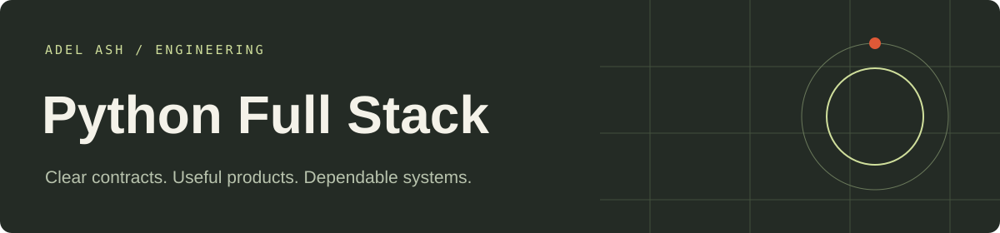

# Python-Full-Stack Engineering

Runnable portfolio applications with explicit business rules, browser interfaces and automated checks. Each application has its own folder. All shared source needed by these projects lives inside this repository.

| Application | Folder |
| --- | --- |
| [Financial Reconciliation and Exception Workbench](fullstack/financial-reconciliation-and-exception-workbench-fullstack) | `fullstack/financial-reconciliation-and-exception-workbench-fullstack` |
| [Ecommerce Order and Inventory Platform](fullstack/ecommerce-order-and-inventory-platform-fullstack) | `fullstack/ecommerce-order-and-inventory-platform-fullstack` |
| [Education Learning and Assessment Portal](fullstack/education-learning-and-assessment-portal-fullstack) | `fullstack/education-learning-and-assessment-portal-fullstack` |

## Setup and verification

# Full-stack application applications

Three independent applications:

- **Finance:** Vue interface and FastAPI/SQLite backend. Start `uvicorn app:app --host 127.0.0.1 --port 8000` from its backend folder after installing the shared Python requirements. In its frontend folder, `pnpm install --frozen-lockfile` and `pnpm dev`. The interface can sign synthetic callbacks, review exceptions, propose adjustments and inspect audit state.
- **Commerce:** Next.js/React with Node route handlers. From its project folder, `pnpm install --frozen-lockfile`, `pnpm dev`, or `pnpm build` and `pnpm start`. Includes local reservations, cancellation, shipment, refund state transitions, outbox retries and role checks.
- **Education:** Angular interface with NestJS backend. Start the shared TypeScript API with this project's `project.json` and run the Angular client on its Vite port. Deterministic assessments, explicit instructor feedback review, versioned publication and audit views.

Backend implementations are shared with the corresponding language demos to prevent business-rule drift. The packaged repository includes those dependencies and frontends. SQLite or in-memory fixture state is used locally. PostgreSQL/Prisma, MongoDB/GraphQL, Redis, Kafka, AWS, Kubernetes and external model services are not configured in these demonstrations. No production authentication or cloud deployment is implied. Only synthetic data is included.

## Repository guide

- Application READMEs include launch commands, sample inputs and workflow details.
- Architecture documents describe storage and failure boundaries.
- GitHub Actions runs stack-specific checks on changes.
- Local roles and sample records are development examples. Keep them on localhost; configure trusted identity, secrets and operational controls for any public deployment.

## Portfolio

[View this stack’s work](https://adelash.vercel.app/python-full-stack) · [Email Adel Ash](mailto:adelash.work@gmail.com)
