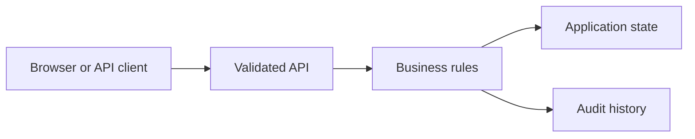

# Ecommerce Order and Inventory Platform

Created a Next.js and Node.js application application for versioned reservations, shipment, cancellation and refund transitions. Added replay-safe request keys and a retryable outbox fixture. Verified stock conflicts and recovery behavior with shared TypeScript tests and documented the local-state boundary.

## Run locally

Start from the `fullstack/` directory of this repository.

```sh
See the application setup in this folder and the stack setup in the parent README.
```

The browser console is available at `http://127.0.0.1:8000` for API applications. For frontend applications, use the frontend development server described in the setup below.

## Architecture



## Workflow

Available actions: `reserve`, `cancel`, `ship`, `refund`, `relay`.

Open `project.json` for the available commands and example inputs when present. Use the operator role to inspect state and audit history. Retry an accepted command with the same identifier to observe replay behavior; change its payload or expected version to exercise conflict handling.

## Verification

Run the automated checks from the stack directory:

```sh
See the stack README for backend and frontend checks.
```

The checks exercise business rules, permission boundaries and failure recovery. Sample records are synthetic. Development credentials are local examples; use managed identity, external secrets and your own deployment controls before exposing services publicly.

## Implementation notes

# Ecommerce Order and Inventory Platform

Next.js/React interface and Node/TypeScript route handlers with local in-memory workflow state. Install with `pnpm install --frozen-lockfile`, run `pnpm dev`, or build with `pnpm build` and run `pnpm start`.

Reserve stock using an idempotency key and expected inventory version. Operator actions cancel, ship and refund; cancellations release stock once. The outbox retains events during a simulated relay failure. Version conflicts reject stale updates. Shared TypeScript tests verify these business rules.

Storage resets when the Node service restarts. The in-memory fixture is designed for one local process and must not be deployed as a distributed transactional backend. PostgreSQL, Prisma, Redis, Kafka and Kubernetes are not connected in this application implementation.

## Architecture

[Architecture and failure boundaries](ARCHITECTURE.md). Shared workflow modules and tests are in the parent stack folder.

