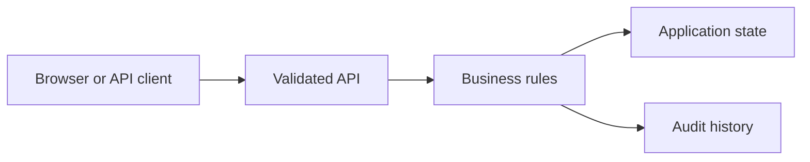

# Education Learning and Assessment Portal

Created an Angular and NestJS assessment application with deterministic scoring and explicit instructor review. Protected feedback publication with role and expected-version checks and retained audit histories. Verified repeated submissions and stale approvals with shared TypeScript tests using synthetic learner records.

## Run locally

Start from the `fullstack/` directory of this repository.

```sh
See the application setup in this folder and the stack setup in the parent README.
```

The browser console is available at `http://127.0.0.1:8000` for API applications. For frontend applications, use the frontend development server described in the setup below.

## Architecture



## Workflow

Available actions: `submit`, `feedback`, `publish`.

Open `project.json` for the available commands and example inputs when present. Use the operator role to inspect state and audit history. Retry an accepted command with the same identifier to observe replay behavior; change its payload or expected version to exercise conflict handling.

## Verification

Run the automated checks from the stack directory:

```sh
See the stack README for backend and frontend checks.
```

The checks exercise business rules, permission boundaries and failure recovery. Sample records are synthetic. Development credentials are local examples; use managed identity, external secrets and your own deployment controls before exposing services publicly.

## Implementation notes

# Education Learning and Assessment Portal

Angular interface with NestJS/TypeScript assessment workflows. Install and build the shared TypeScript API, then start it using this project's `project.json`. Start the included Angular client with `pnpm dev`.

Submit three rubric answers before the deadline; scoring is deterministic. An instructor proposes feedback, inspects the result and publishes it with the expected version. Duplicate submissions, unauthorized publication and stale edits are rejected. The audit view records each successful action.

State is local and in memory. MongoDB, GraphQL, external model providers, AWS and a live release pipeline are not configured. Feedback text is an instructor-reviewed fixture, not an automated grade. See the shared workflow tests and verification report.

## Architecture

[Architecture and failure boundaries](ARCHITECTURE.md). Shared workflow modules and tests are in the parent stack folder.

