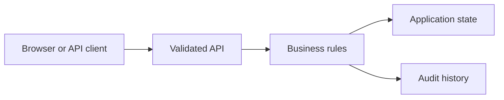

# Financial Reconciliation and Exception Workbench

Built a Vue.js and FastAPI application workbench for signed callbacks, SQLite reconciliation and reviewer approvals. Kept financial calculations deterministic and retained audit records. Verified duplicate events, signature failures and conflicting approvals with pytest using synthetic invoices.

## Run locally

Start from the `fullstack/` directory of this repository.

```sh
See the application setup in this folder and the stack setup in the parent README.
```

The browser console is available at `http://127.0.0.1:8000` for API applications. For frontend applications, use the frontend development server described in the setup below.

## Architecture



## Workflow

Available actions: `callback`, `propose`, `approve`.

Open `project.json` for the available commands and example inputs when present. Use the operator role to inspect state and audit history. Retry an accepted command with the same identifier to observe replay behavior; change its payload or expected version to exercise conflict handling.

## Verification

Run the automated checks from the stack directory:

```sh
See the stack README for backend and frontend checks.
```

The checks exercise business rules, permission boundaries and failure recovery. Sample records are synthetic. Development credentials are local examples; use managed identity, external secrets and your own deployment controls before exposing services publicly.

## Implementation notes

# Financial Reconciliation and Exception Workbench

Vue + FastAPI demonstration using synthetic invoices, signed callbacks and SQLite transactions. Exact payments match deterministically; partial payments enter an exception workflow. Reviewer proposals require approval and cannot overdraw balances. Audit records preserve the actor and action.

From `backend`: install the shared Python requirements and run `uvicorn app:app --host 127.0.0.1 --port 8000`. From `frontend`: run `pnpm install --frozen-lockfile`, then `pnpm dev`. Open the Vite address, choose callback and click **Sign fixture payload**, then **Run workflow**. Repeating it cannot charge the invoice again. Adjust the amount with the same event ID to observe a conflict.

The signing key and role tokens are local fixtures. No live payment provider, PostgreSQL, Redis or model service is connected. Tests in the shared Python module cover signatures, replay conflicts and concurrent approval decisions.

## Architecture

[Architecture and failure boundaries](ARCHITECTURE.md). Shared workflow modules and tests are in the parent stack folder.

